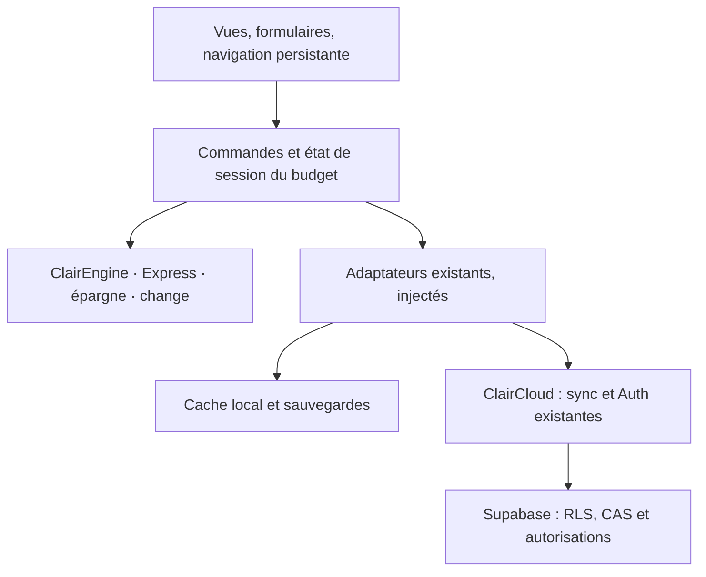

# CLAIR — plan de refactorisation progressive proposé

> Pour les agents : utiliser une exécution par lots avec tests de comportement et revue avant passage au lot suivant. **Plan validé par l’utilisateur (« Je valide tout »), implémentation progressive autorisée sur `refactor/clair-professional-foundation`. Aucun accord de production.**

**But :** rendre CLAIR compréhensible et modifiable par un nouveau développeur, en corrigeant les défauts prouvés sans changer son produit ni ses données.

**Architecture :** conserver JavaScript, le SDK Supabase existant, la PWA et le HTML autonome. Rendre les sources et frontières explicites, générer le livrable et isoler progressivement commandes, données et présentation.

**Technologies :** HTML/CSS/JavaScript, Node pour outillage/tests, Playwright déjà utilisé, Supabase/PostgreSQL/Deno existants. Aucun changement de framework.

**Spécification et preuves :** [ARCHITECTURE_AUDIT.md](ARCHITECTURE_AUDIT.md), base `c55c8ea`, code public `4673b2a`. Les nouveaux chemins ci-dessous sont des propositions, pas des modules déjà créés.

## Contraintes communes

- Aucun montant, historique, ID catégorie/transaction/propriétaire ou format JSON v3 changé par une extraction.
- Centimes entiers, devises EUR/XOF/XAF/USD/GBP/MAD/CAD/CHF, calendriers civils Paris et arrondis actuels conservés.
- Idempotence/autoKey, epoch, révisions, operationId, conflits, hors connexion et récupération restent des contrats bloquants.
- Pas de second moteur de transactions, de synchronisation ou d’authentification. Réutiliser ClairEngine/ClairCloud/ClairAuthEmail/Express et composants avant d’étendre.
- Aucun changement d’interface intentionnel en dehors des anomalies validées ; dock liquide, profil et mouvement réduit préservés.
- Autres applications : aucune modification de leur fonctionnement ; le paquet doit préserver les ressources Masterboard actuelles.
- Branche dédiée après validation, petits commits cohérents, état court actualisé. Fusion main, publication Vercel et modifications de base réelle nécessitent leur accord propre.
- Pas de migration destructive. Toute correction SQL est préparée/testée localement, additive et revue ; aucune application en production implicite.
- Diagnostics sur fixtures uniquement, pas de nouvel email/compte réel automatique. Secrets jamais dans code, logs ou rapports.

## Choix proposé et architecture cible

La seule approche adaptée aux contraintes actuelles est une modularisation des sources **avec assemblage de l’HTML autonome**. Un simple passage à des imports multi-fichiers au runtime remettrait en cause le téléchargement et file:// ; une réécriture de framework ajoute un risque non justifié. Les fichiers existants peuvent rester à leur place pendant la transition ; les renommages seuls ne sont pas un objectif.

Ce diagramme montre les dépendances ; le retour des données aux vues passe par notifications/modèles de vue, sans import de la présentation par le domaine.

Cibles utiles au fil des lots :

| Cible | Responsabilité | Existant consommé |
|---|---|---|
| `clair/domain/engine.js` | Noyau pur extrait sans changement de calcul | Bloc ClairEngine, change inclus initialement |
| `clair/application/budget-commands.js` | Préparer/valider des opérations métier | Engine, ExpressCore, invariants épargne |
| `clair/application/budget-session.js` | Snapshot propriétaire, persistance et notification | commit et hooks actuels ; pas de seconde copie financière autoritaire |
| `clair/ui/navigation.js`, `clair/ui/page-host.js` | Monter/actualiser/disposer, focus et état d’écran | Dock existant, switchPage et render |
| Sources `accounts/*` actuelles | Garder d’abord les APIs fiables, injecter leurs dépendances progressivement | ClairCloud, ClairAuthEmail, category-art, glass-ui, fragments UI |
| `clair/config/public.js`, `supabase/functions/_shared/origins.mjs` | Adresses publiques/variantes serveur explicites | Paramètres actuels ; secrets serveur restent en environnement |
| `tools/clair/*`, template source CLAIR | Assemblage, recette du paquet, vérification des miroirs/live | HTML et SDK existants, configuration Vercel actuelle |
| `docs/architecture/CLAIR.md` | Guide humain, flux et décisions adoptées | MAP/STATE/DEPLOYMENT et ce rapport |

Le session store détiendra le budget courant, pas un solde dérivé supplémentaire. ClairCloud garde ses métadonnées de synchronisation/CAS ; ses événements entrent dans le store par des opérations explicites, au lieu de modifier une seconde variable financière libre. Aucun cache monétaire global supplémentaire prévu sans mesure.

## Revue à appliquer à chaque lot

1. Même propriétaire/epoch seulement : un résultat tardif ne touche jamais le contexte suivant.
2. Échec de quota/validation : aucune réussite fictive, mémoire/cache/métadonnées cohérents.
3. Écriture réussie puis erreur UI : pas d’annonce mensongère de rollback.
4. Navigation/sync rapides : état utile préservé pour le même propriétaire, purgé lors d’un changement de compte.
5. Réponse fournisseur perdue : ne pas réutiliser sans contrôle une capacité sensible ni promettre une émission exactement une fois.

Les mises à jour sans changement doivent aussi tenir compte du changement de jour/mois Europe/Paris : éviter un rendu inutile ne doit pas figer les échéances ou statistiques temporelles.

## Lots et ordre de dépendance

Les estimations sont en jours de travail, tests et revue compris ; S = faible, M = moyenne, L = élevée. Chaque lot peut être refusé indépendamment. Dépendances : 0 → 1/2/3A ; 0 → 4 → 5 → 6. 3B exige sa revue de protocole et ses essais SQL avant migration.

### Lot 0 — Établir le filet de vérification et l’entrée humaine

**Priorité : immédiate. Complexité M, 1–2 jours. Risque faible.**

Fichiers : créer `tools/clair/mirrors.json`, `tools/clair/check-mirrors.mjs`, `clair/accounts/test-mirrors.cjs` ; modifier `clair/LISEZ-MOI.md`, `clair/accounts/README.md`, `.github/workflows/clair-checks.yml`, documents de contribution.

Interface : inventaire déclaratif des26miroirs et3exceptions, ordre/position explicites ; commande de contrôle en lecture seule retournant non-zéro sur copie absente, différente ou en double. L’outil ne corrige pas automatiquement un problème.

- [x] Caractériser l’HTML/SDK/moteur courants et les26miroirs ; aucune dérive actuelle à masquer.
- [x] Ajouter des tests : suppression d’une copie, modification d’un caractère et duplication sont refusées ; exceptions externes admises.
- [x] Exécuter `node tools/clair/check-mirrors.mjs` sur la base intacte et `node clair/accounts/test-mirrors.cjs` sur fixtures.
- [x] Corriger la documentation humaine : Vercel, modes local/compte synchronisé, données envoyées et véritables tests ; préserver les historiques datés utiles.
- [x] Documenter Node24 constaté et Playwright1.64.1 déjà utilisé, puis figer l’environnement d’essai avant de réorganiser les chargeurs.
- [x] Commit limité à garde-fous/documentation, aucune modification de produit.

Acceptation : inventaire complet, contrôle fiable, nouveau mainteneur sait ouvrir CLAIR et lancer un test. Le choix précis d’une version Node de CI doit être vérifié dans l’environnement de développement, pas supposé installé par un clone.

### Lot 1 — Rendre les écritures et versions cohérentes

**Priorité immédiate, F1/F2. Complexité M/L, 2–3 jours.**

Fichiers : `clair/index.html` (`commit`, rapprochement, normalize/import), tests nouveaux `clair/accounts/test-budget-commit.cjs`, `test-schema-versions.cjs` ; tests existants local/fluidity/cloud. Garder leurs noms/globs actuels pour la CI.

Interfaces conservées : `commit(change,message,withSound) -> boolean`, `ClairEngine.normalize(input) -> BudgetV3` ou erreur. Proposer la préparation d’un candidat complet avant l’unique écriture ; ne pas déplacer le moteur dans le même commit.

- [x] Ajouter le cas −10 000 000 000 → +100 000 000 EUR : refus sans changement de mémoire/cache/snapshot/cloud metadata, modes local et connecté fictif.
- [x] Tester quota avant écriture et exception de rendu/statut après écriture : la réussite persistante doit rester distinguée de l’échec d’un effet secondaire.
- [x] Tester version4/openingCents123400 : refus avant confirmation d’import ; caractériser les vrais formats historiques à conserver, dont openingBalance en unités majeures sans version.
- [x] Valider intégralement le candidat et l’ajustement avant persistance ; séparer les effets post-persistance de la possibilité de rollback.
- [x] Exécuter les nouveaux tests, puis `test-local`, `test-fluidity`, `test-cloud`, `test-currency`, `test-express-*`, `test-savings` concernés et le contrôle des miroirs.
- [x] Commit de correction avec preuve de non-régression ; aucune migration ni modification de données réelles.

Risque : rejeter une ancienne sauvegarde valide ou perdre une métadonnée lors d’une normalisation. Les fixtures de migration et les champs Express/épargne/devise doivent être explicitement conservés.

### Lot 2 — Fermer les courses de contexte existantes

**Priorité immédiate, F3/F6. Complexité M, 1–2 jours.**

Fichiers : `clair/index.html` (photo/contexte), `clair/accounts/cloud.js` et miroir ; `test-cloud.cjs`, nouveau `test-photo-context.cjs` ou scénario dans le harnais UI existant.

Interfaces réutilisées : `budgetReplacementContext/assertBudgetReplacementContext` et epoch de ClairCloud. Pas de second système de tickets de compte ; seul un numéro de sélection photo distingue les deux choix du même contexte.

- [x] Repro déterministe : photo A suspendue, budget B adopté, fin A ; B ne reçoit aucune ancienne photo. Deux photos du même contexte : le dernier choix gagne.
- [x] Repro conversion A suspendue, entrée B, fin/erreur A : B est synchronisé après libération sans attendre un polling ; A ne remplace jamais B.
- [x] Ajouter garde de contexte après décodage et rattrapage de sync au changement d’epoch, en reprenant les mécanismes déjà présents.
- [x] Tester interruptions, erreurs, changement devise, visibilité et double sélection ; aucune requête réelle.
- [x] Vérifier miroirs et commit isolé.

Risque : rejeter une opération encore légitime ou réintroduire un sync concurrent. Préférer abandon explicite du résultat obsolète à une réaffectation au nouveau compte.

### Lot 3A — Aligner les origines et destinations de l’aide/récupération

**Priorité haute, F4. Complexité S/M, 0,5–1 jour.**

Fichiers : `supabase/functions/clair-{account-help,account-recovery,device-unlock}/{handler.mjs,index.ts}` concernés, `clair/accounts/reset-page.js`, configuration publique et `_shared/origins.mjs` si la responsabilité est effectivement commune ; tests récupération/déblocage existants.

- [x] Écrire les contrats : production Vercel exacte acceptée, hôtes hostiles/faux sous-domaines et previews non autorisés refusés, permissions/quotas inchangés.
- [x] Centraliser les adresses d’environnement en conservant des allowlists propres aux politiques de chaque service ; conserver les anciennes destinations nécessaires à la transition explicitement.
- [x] Tester OPTIONS et génération de destination via doubles locaux, sans émission/reset.
- [x] Préparer les changements serveur/client, vérifier leurs contrats puis commit. Déploiement serveur hors de ce lot sans accord distinct.

### Lot 3B — Rendre l’émission de déblocage récupérable et sûre

**Priorité haute mais revue séparée, F5. Complexité L, 3–5 jours.**

Fichiers : `supabase/device-unlock.sql`, handler de déblocage, contrats d’adaptation du provider et tests SQL/Node isolés. Préparer une migration additive seulement après revue du protocole ; ne pas réappliquer le SQL historique en production.

- [x] Tester la transition actuelle qui échoue : premier503 puis expired sans reprise.
- [x] Décrire les états internes d’émission, lease et résultat indéterminé ; garder le contrat client pending/ready/expired et la capacité liée au bon propriétaire.
- [x] Échec certain avant émission : reprise bornée possible. Réponse perdue après émission : ne jamais rouvrir automatiquement la capacité comme si rien n’avait eu lieu. Documenter l’arbitrage/reprise administrative.
- [x] Tests locaux : expiration, deux polls concurrents, ancien mot de passe invalidé dans le double, succès, timeout avant/après émission, tentative après consommation et compte différent.
- [x] Vérifier ACL/RLS dans PostgreSQL jetable, conservation des demandes existantes et absence de secrets persistants supplémentaires ; revue sécurité avant commit/migration proposée.

Risque le plus élevé : élargir involontairement une capacité de récupération. Aucune promesse « exactement une fois » de bout en bout ni mécanisme de retry aveugle.

### Lot 4 — Produire un livrable reproductible à partir d’un commit

**Priorité structurelle, F9/F10. Complexité M, 2–4 jours. Dépend de0.**

Fichiers proposés : `tools/clair/{build,package,verify-package,verify-live}.mjs`, `tools/clair/vercel.json`, `clair/app/index.template.html`, inventaire de miroirs ; `.github/workflows/clair-live-check.yml`, documentation de publication.

- [x] Extraire un template qui garde l’ordre des scripts, le markup, les canoniques et le SDK exacts. Sources une fois, index autonome comme artefact généré versionné.
- [x] `node tools/clair/build.mjs --check` compare sans écrire ; mode explicite de génération seulement pour les sources validées.
- [x] Première génération identique octet pour octet à l’index courant ; deux générations successives identiques, sans timestamp variable.
- [x] `package.mjs` produit un dossier à partir des seuls fichiers suivis et de la recette ; `verify-package.mjs` vérifie sources/SHA/tailles/exclusions, redirection, absence de fixtures/secrets/noindex démo et ressources Masterboard conservées.68fichiers est la baseline, pas une limite immuable pour les futures évolutions.
- [x] Versionner la configuration sous tools, copiée à la racine du paquet, sans imposer une configuration globale aux autres apps du monorepo.
- [x] Le contrôle live reçoit domaine Vercel et commit/manifeste explicites ; le contrôle GitHub historique ne se présente plus comme validation de production.
- [ ] Tests du fichier téléchargé, file://, PWA/cache offline et absence de requête externe imprévue. Aucun déploiement automatique ajouté.

La fusion de branches et la politique de tags/releases restent une décision d’intégration distincte ; documenter toujours le commit de livraison réel.

> Vérification locale : HTTP téléchargement/PWA/cache verts ; ouverture navigateur file:// bloquée par politique gérée (NON EXÉCUTÉE), preuve réelle à compléter dans un environnement autorisé. Aucun contournement ni déploiement.

### Lot 5 — Extraire le noyau puis la frontière application, sans changement métier

**Priorité après garde-fous, F1/F8. Complexité M pour moteur (1–2 jours), L pour orchestration (3–5 jours). Dépend de4 et corrections1/2.**

Fichiers : `clair/domain/engine.js`, `clair/application/{budget-commands,budget-session}.js`, template/manifest ; hooks de `account-ui.js` et orchestration inline remplacés progressivement. Ne pas déplacer tous les fichiers par préférence de nommage.

- [x] Extraire le noyau pur initialement avec son change inclus ; conserver toutes les méthodes publiques ClairEngine par adaptateur, mêmes centimes, dates et JSON.
- [x] Tester directement le canonique, puis garder des tests d’intégration de l’HTML réellement généré ; retirer les réinjections de secours qui masquent une omission.
- [x] Contrat de commande proposé : `prepareBudgetChange(current, change) -> validatedCandidate` sans stockage/DOM ; session : `getSnapshot`, `commit`, `adoptRemote`, `subscribe`, `dispose`, avec contexte propriétaire explicite et snapshots isolés.
- [x] Les commandes manuel/Express/épargne gardent leurs différences ; validation commune à l’entrée de persistance, pas constructeur universel.
- [x] ClairCloud conserve révisions/dirty/CAS/idempotence ; adoption distante passe par une opération du session store vérifiée, jamais par une variable UI libre.
- [x] Tester sauvegarde hors ligne/reconnexion, ACK sans changement, réponse perdue, conflit, correction/suppression et deux comptes. La CI Node/SQL/navigateur prévue doit passer sur chaque sous-lot avant le suivant.
- [x] JSDoc des données/contrats aux frontières ; aucun passage global TypeScript imposé. Noms explicites et formatage lisible des sources extraites, sans reformater SDK ou HTML généré ; stabiliser les chargeurs avant toute réorganisation de mise en forme. Commits séparés moteur, commandes et session.

### Lot 6 — Conserver l’identité des vues et rendre leurs dépendances explicites

**Priorité UX et maintenance, F7/F8. Complexité M/L, 2–4 jours. Dépend des frontières stables.**

Fichiers : `clair/ui/{navigation,page-host}.js`, `index.html` généré/template, fragments `journal/profile/dashboard/account-ui` concernés ; nouveau `verify-render-lifecycle.cjs`, tests navigation/glass/profile existants.

La conservation des boutons desktop peut être livrée dans un petit sous-lot autonome dès les garde-fous0, sans attendre toute l’extraction du store. La conservation générale des vues suit les frontières stables.

Interface cible : `mount(host, context)`, `update(viewModel, context)`, `dispose()` pour les vues nécessitant un cycle de vie. Les vues simples peuvent rester des fonctions de rendu ; ne pas fabriquer un mini-framework.

- [x] Menu desktop : même bouton après activation clavier, focus/aria-current conservés. Réutiliser la sélection commune ; garder la mécanique liquide mobile existante.
- [x] Écran courant : recherche/focus/sélection, détails et scroll restent cohérents après ACK/visibilité ; pas de render complet pour état inchangé.
- [x] Navigation réelle : contexte de page remis à jour, brouillons traités explicitement ; changement de compte purge les états privés, jamais conservation intercompte au nom de performance.
- [x] Tester interruptions rapides, mouvement réduit, pointeur/annulation/clavier, aucun listener/timer/observer croissant après montages/démontages.
- [x] Extraire les fragments avec paramètres nommés plutôt que déplacer la même fermeture ; commencer par le journal qui possède déjà une mise à jour ciblée.
- [x] Mesurer créations DOM/rendus/requêtes et temps sur mêmes fixtures avant/après. Aucun objectif arbitraire de pourcentage ni optimisation de cache financier non mesurée.

## Documentation et transmission au fil de chaque lot

Créer `docs/architecture/CLAIR.md` : architecture actuelle/acceptée, rôle des modules, flux local/cloud, schéma v3, ajout de fonction et modification de composant, tests et décisions. Actualiser MAP après les déplacements, STATE après chaque lot, DEPLOYMENT après changement réel de recette. Ne pas réécrire les archives ni dupliquer le code dans SOURCES.md.

Checklist de toute nouvelle fonctionnalité, conforme à la demande utilisateur : rechercher l’existant ; préférer son extension ; lire contrats/dépendances/effets secondaires ; réutiliser commandes et composants ; tests de comportement ; documentation et dette signalées ; aucune seconde implémentation d’une responsabilité déjà couverte ; pas de déclaration de réussite sans preuve.

Préparation des évolutions : devises/catégories par contrats existants, Express par ses commandes, statistiques par sélecteurs purs, notifications par services existants. Une future banque serait un adaptateur produisant des commandes validées ; aucune connexion bancaire, import ou prédiction financière développé maintenant. Abonnements et Masterboard gardent leurs frontières serveur et d’autorisation.

## Vérification, critères de fin et décisions attendues

- Pour chaque sous-lot : comportement de référence caractérisé, nouvelle régression reproduite, correction minimale, vérification concernée, miroirs/artefact et diff relus, commit explicite.
- Après intégration : suites Node, PostgreSQL isolé/RLS et parcours navigateur requis, dont inscription/connexion à transport contrôlé, navigation, ajout/correction dépense, devise, statistiques, offline/reconnexion/déconnexion. Tests réels d’email uniquement sur autorisation distincte si nécessaire.
- Séparer dans le rapport tests réussis, échecs, non exécutés et risques résiduels ; ne pas confondre SMTP local, mock navigateur et réception réelle.
- Maintenir l’HTML autonome et le paquet reproductible, sans changements financiers imprévus ; toute différence de données de référence bloque la livraison.
- Public/API Supabase réel inchangé sans autorisation ; aucun lot ne vaut validation implicite d’une publication ou migration.

**À faire d’abord après validation : lots0,1,2 et3A ; instruire3B avec revue dédiée.** Ensuite4→5→6. Les renommages purement esthétiques, réécriture framework, nouvelles banques/abonnements/analyses et micro-optimisations sans mesure peuvent attendre.

**Décision : plan validé ; exécution suivie dans STATE et par commits de lots, sans fusion ni publication.**

## Bilan d’exécution

Lots0–6 implémentés et revus par lots, finitions de qualité testées. Rapport `../architecture/REFACTOR_VERIFICATION.md`. Revue globale approuvée au commitd07f0f6 (FINAL_REVIEW.md). Seule couverture navigateurfile réelle reste nonexécutée sous politique gérée ; limites physiques/backendréel explicites. Aucune publication ni migration réelle.
